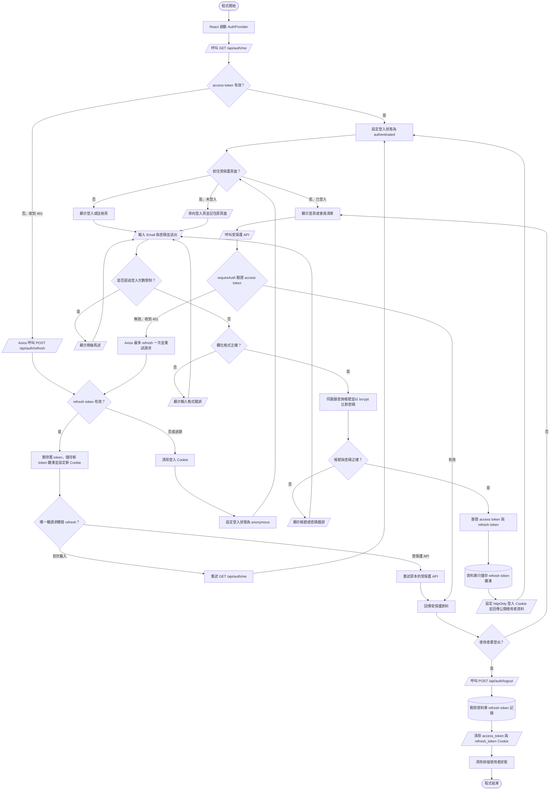

# 登入與驗證流程

本文依目前專案的 React 前端與 Express／MongoDB 後端整理，涵蓋初次載入、登入、受保護 API、憑證更新及登出。

## 完整流程圖

## 流程重點

- **初次載入：** `AuthProvider` 呼叫 `GET /api/auth/me` 還原登入狀態；`ProtectedRoute` 在確認完成前顯示載入狀態。
- **登入：** 表單送出 Email 與密碼；伺服器端以 Zod 驗證、bcrypt 驗證密碼，並以一致的 `401 帳號或密碼錯誤` 避免透露帳號是否存在。登入端點每個來源 15 分鐘最多 10 次。
- **登入成功：** 後端透過 Cookie 傳送 15 分鐘的 access token 與 7 天的 refresh token；兩者皆為 `httpOnly`，前端 JavaScript 不讀取 token。資料庫只儲存 refresh token 雜湊。
- **API 授權與更新：** `requireAuth` 驗證 access token。受保護請求收到 `401` 時，Axios 攔截器最多嘗試 refresh 一次；refresh 成功會輪替 refresh token 並重試原請求。
- **登出：** 後端刪除資料庫中的 refresh token 記錄並清除兩個 Cookie；前端清除登入者狀態。
- **前端登入狀態不代表授權：** 每個受保護的後端端點仍須使用 `requireAuth` 驗證 Cookie 中的 access token。

## 主要程式位置

- 登入頁與送出後導向：[frontend/src/LoginPage.jsx](./frontend/src/LoginPage.jsx)
- 登入狀態、啟動時還原及登出：[frontend/src/AuthContext.jsx](./frontend/src/AuthContext.jsx)
- Cookie 請求與 refresh／重試：[frontend/src/api.js](./frontend/src/api.js)
- 受保護頁面路由：[frontend/src/ProtectedRoute.jsx](./frontend/src/ProtectedRoute.jsx)
- 登入端點與速率限制：[backend/routes/auth.routes.js](./backend/routes/auth.routes.js)
- 帳密驗證、token 簽發／輪替及登出：[backend/controllers/auth.controller.js](./backend/controllers/auth.controller.js)
- access token 驗證：[backend/middleware/requireAuth.js](./backend/middleware/requireAuth.js)
- 使用者與 refresh token 資料：[backend/models/User.js](./backend/models/User.js)、[backend/models/RefreshToken.js](./backend/models/RefreshToken.js)